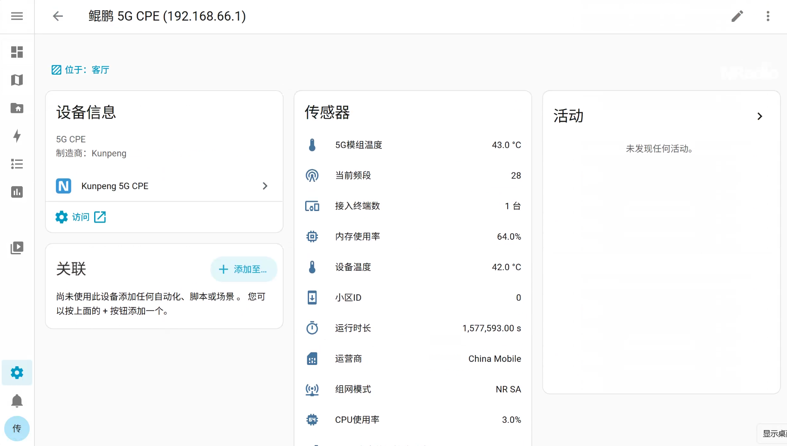

# Kunpeng Cpe for Home Assistant


[](https://github.com/hacs/integration)

把鲲鹏5G CPE接入Home Assistant，读取蜂窝信号、设备状态等数据。
目前仅在C2000 pro（型号C2000-518）上实测，ha效果如下图所示。



## 数据清单

目前支持传感器清单如下

| # | 实体名称 | translation_key | 单位 | Device Class | 示例值 |
|---|---|---|---|---|---|
| 1 | 设备温度 | `device_temp` | °C | `temperature` | `41` |
| 2 | 5G模组温度 | `module_temp` | °C | `temperature` | `42` |
| 4 | CPU 使用率 | `cpu_usage` | % | — | `1` |
| 5 | 内存使用率 | `memory_usage` | % | — | `63` |
| 6 | RSRP 参考信号接收功率 | `rsrp` | dBm | `signal_strength` | `-74` |
| 7 | RSRQ 参考信号接收质量 | `rsrq` | dB | — | `-2` |
| 8 | SINR 信噪比 | `sinr` | dB | — | `8` |
| 9 | 当前频段 | `band` | — | — | `28` |
| 10 | 小区 ID | `cell_id` | — | — | `15681D02B` |
| 11 | 组网模式 | `mode` | — | — | `NR SA` |
| 12 | 运营商 | `isp` | — | — | `China Mobile` |
| 13 | 接入终端数 | `connected_devices` | 台 | — | `1` |
| 14 | 运行时长 | `uptime` | s | `duration` | `1317058` |
| 15 | 模组版本 | `firmware_version` | — | — | `RG200***7M2G` |
| 16 | imei | `imei` | — | — | `868***742` |
| 17 | imsi | `imsi` | — | — | `460***521` |

以下字段涉及敏感信息，已做如下处理：

- 🔒 `imsi`：**不暴露为实体**
- 🔒 `imei` / `iccid`：作为诊断实体提供，**默认禁用**，需在实体设置里手动启用


## 安装

### 方式一：手动安装

1. 下载本仓库，把 `custom_components/kunpeng_cpe/` 整个文件夹复制到 HA 配置目录下的 `config/custom_components/`
2. 重启 Home Assistant
3. **设置 → 设备与服务 → 添加集成** → 搜索 `Kunpeng CPE`
4. 填写配置（见下节），提交


### 方式二：HACS

1. HACS → **集成** → 右上角三点 → **自定义存储库**
2. 填入本仓库 URL，类别选 **Integration**
3. 搜索 `Kunpeng CPE` 安装，重启 HA
4. 同方式一第 3 步添加集成


## 配置

| 字段 | 必填 | 默认值 | 说明 |
|---|---|---|---|
| 设备IP | ✅ | 192.168.66.1 |  |
| 端口 | ❌ | `80` | |
| 用户名 | ✅ | `root` |  |
| 密码 | ✅ | `admin` |  |
| 刷新间隔 | ❌ | `30` 秒 | 建议 ≥10 秒，过短会给设备带来压力 |

## 项目结构

```
ha-kunpeng-cpe/
├── custom_components/
│   ├── kunpeng_cpe/
│   │   ├── __init__.py               # 集成入口
│   │   ├── manifest.json             # 集成元数据
│   │   ├── config_flow.py            # UI配置
│   │   ├── const.py                  # 跨模块常量
│   │   ├── coordinator.py            # 轮询调度 + 错误转换 + 会话生命周期
│   │   ├── api.py                    # 纯HTTP API封装
│   │   ├── sensor.py                 # 传感器描述 + 实体类
│   │   ├── translations/
│   │   │   └── zh-Hans.json          # 中文文案
│   │   └── brand/
│   │       ├── icon.png              # 正方形图标
│   │       └── logo.png              # 配置界面Logo
│   └── scripts/
│       └── test_kunpeng_api.py       # 单独测试api.py
└── README.md
```

## API说明

本项目通过设备的原生HTTP接口读取数据，不依赖厂商App或云服务，目前涉及两个接口。

### 接口1：登录

| 项 | 值 |
|---|---|
| URL | `http://<设备IP>/cgi-bin/luci` |
| Method | `POST` |
| Request | luci_username=<用户名> & luci_password=<密码> & luci_channel=simple |
| Response | 响应 `Set-Cookie` 包含 `sysauth=<hash>`，后续请求须携带 |

### 接口2：状态

| 项 | 值 |
|---|---|
| URL | `http://<设备IP>/cgi-bin/luci/nradio/status/runtime/wan,cpe_4` |
| Method | `GET` |
| Response | JSON，完整响应样例见 [`docs/status_response_sample.jsonc`](docs/status_response_sample.jsonc) |

## 调试工具

集成目录下的 `scripts/test_kunpeng_api.py` 可以**脱离 Home Assistant** 直接验证登录与状态接口，是排查问题的第一工具。

```bash
pip install aiohttp
cd {project_root}
python scripts/test_kunpeng_api.py \
    --host 192.168.66.1 \
    --username root \
    --password admin \
    -v
```

## 贡献

欢迎提交 Issue 与 PR。提交设备兼容性问题时请附上：

- 设备型号与固件版本（cpe[0].model / cpe[0].revision）
- test_kunpeng_api.py -v 的完整输出（请先脱敏 IMEI / IMSI / ICCID / WiFi 密码）
- HA 版本

## 作者

本项目由 **[@lichuanqi](https://github.com/lichuanqi)** 与 **DeepSeek** 共同完成。

特别声明：**AI 不背锅**。所有在生产环境跑出来的 bug，都算人类的；所有精妙的架构设计，都算 AI 的。这种分工非常公平，双方均无异议。

如果你也想用 AI 从零开发一个 HA 集成，欢迎参考本项目的结构与 [api.py](custom_components/kunpeng_cpe/api.py) 的独立调试设计——这部分是 AI 写的，我替它骄傲一下。